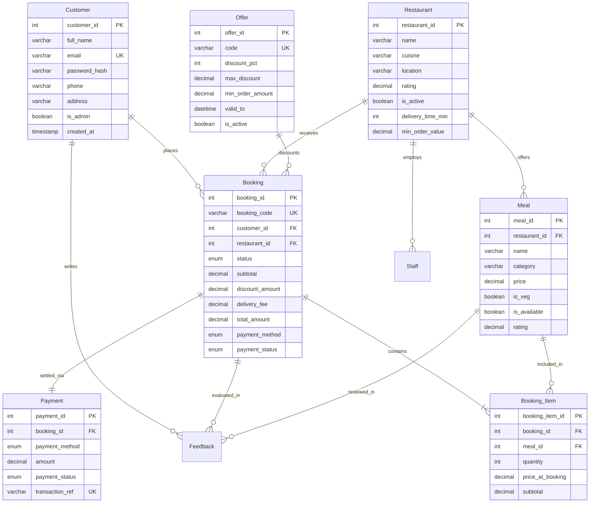

# Meal Booking System
> **"Smart Meal Discovery & Booking Platform"**

[](https://www.python.org/)
[](https://flask.palletsprojects.com/)
[](https://www.mysql.com/)
[](LICENSE)

A complete, modern, and realistic database-driven food discovery and booking web application. Inspired by modern consumer food platforms, **Meal Booking System** is built specifically for a Computer Science & Engineering (CSE) DBMS portfolio, demonstrating industrial-grade relational database modeling, real SQL constraints, stored procedures, triggers, views, and complex aggregations behind a responsive web interface.

---

## 📸 Overview & Key Highlights

- **Pure Relational Backbone**: Built directly on **MySQL** with normalized 3NF tables, foreign key constraints (`CASCADE` & `SET NULL`), `CHECK` domain rules, compound indexes, and ACID-compliant transactional booking checkout.
- **Realistic Pune Eateries**: Curated fictional restaurants and menus across Pune localities (**Kothrud, Baner, Karve Nagar, Aundh, Viman Nagar, Shivajinagar, Koregaon Park, Hadapsar**).
- **Interactive Micro-UI**: Pure HTML5, modern CSS3 variables, and vanilla JavaScript for real-time cart adjustments, toast notifications, dietary badges (`Veg`/`Non-Veg`), and coupon calculations without heavyweight frontend frameworks.
- **Instant Demo Evaluation**: Includes 1-click test credentials for both Customer and Administrator personas.

---

## 🛠️ Tech Stack

| Layer | Technology | Purpose |
| :--- | :--- | :--- |
| **Backend** | Python 3, Flask 3.1 | Modular routing, session state, parameterized SQL integration |
| **Database** | MySQL 8.0+ / 9.x | Relational storage, integrity constraints, triggers & procedures |
| **Connector** | PyMySQL 1.1 | Pure Python MySQL client with dictionary cursor support |
| **Frontend** | HTML5, CSS3, Vanilla JS | Responsive grid, cards, interactive modals, toasts, badge indicators |
| **Icons & Typography** | Font Awesome 6, Plus Jakarta Sans | Modern culinary aesthetic and typography |

---

## 🗄️ Database Design & Relational Schema

The database model (`meal_booking_db`) consists of 9 core relational entities designed to eliminate redundancy while preserving referential integrity:



### Core Entities & Domain Constraints
1. **`Customer`**: User credentials with Werkzeug PBKDF2/scrypt password hashing and email uniqueness.
2. **`Restaurant`**: Operating parameters including `delivery_time_min > 0` and `rating` checked between `1.0` and `5.0`.
3. **`Meal`**: Individual food items with category, veg status, `price > 0.00`, and availability flag.
4. **`Booking`**: Master order record with unique human-readable code (e.g. `MB1001`), delivery address, and status lifecycle (`Pending`, `Confirmed`, `Preparing`, `Out for Delivery`, `Delivered`, `Cancelled`).
5. **`Booking_Item`**: Many-to-Many junction table recording historical purchase price (`price_at_booking`) to safeguard against future menu price updates.
6. **`Payment`**: Transaction audit tracking payment mode (`COD`, `UPI`, `Card`), timestamps, and generated transaction references.
7. **`Offer`**: Promotional discount rules validating percentage, max cap, and temporal validity (`valid_from` to `valid_to`).
8. **`Feedback`**: Customer ratings (`1-5` stars) and reviews linked to delivered orders.
9. **`Staff`**: Delivery logistics and restaurant operational assignments.

---

## 💡 DBMS Concepts Demonstrated

This repository illustrates practical database engineering techniques:

- **BCNF / 3NF Normalization**: Zero transitive dependencies; order line items isolated in `Booking_Item`.
- **Integrity Constraints**: `CHECK (price > 0)`, `CHECK (rating BETWEEN 1 AND 5)`, `NOT NULL`, `DEFAULT`, and `UNIQUE`.
- **Foreign Key Cascades**: `ON DELETE CASCADE` for order line items; `ON DELETE SET NULL` for staff or coupon references.
- **Relational Views (`database/views.sql`)**:
  - `v_restaurant_summary`: Aggregated menu statistics, minimum/maximum dish prices, and item counts.
  - `v_popular_meals`: Top-selling meals joined with restaurant metadata and gross sales.
  - `v_booking_summary`: Multi-table joins consolidating customer, kitchen, discount, and payment state.
  - `v_customer_stats`: Customer lifetime ordering metrics and total spend.
- **Triggers (`database/triggers.sql`)**:
  - `trg_prevent_unavailable_meal`: Raises `SQLSTATE '45000'` if an unavailable meal is added to an order.
  - `trg_update_meal_rating_after_feedback`: Automatically recalculates `Meal.rating` whenever customer reviews are inserted.
  - `trg_update_restaurant_rating_after_feedback`: Propagates meal satisfaction into the parent `Restaurant.rating`.
- **Stored Procedures (`database/procedures.sql`)**:
  - `sp_get_admin_dashboard_stats()`: Single-call analytical summary of platform KPIs.
  - `sp_get_restaurant_analytics()`: Grouped sales metrics by restaurant.
  - `sp_get_customer_profile_stats(customer_id)`: Aggregates lifetime value, favorite cuisine, and completed orders.
  - `sp_validate_offer(code, subtotal, ...)`: Enforces temporal and cart value limits for coupon codes.
- **Showcase Queries (`database/queries.sql`)**: 12 categorized queries demonstrating `INNER JOIN`, `LEFT JOIN`, `GROUP BY`, `HAVING`, `WHERE`, `ORDER BY`, `LIMIT`, and subqueries.

---

## 📁 Project Structure

```text
Meal-Booking-System/
├── LICENSE
├── README.md
├── requirements.txt
├── .env.example
├── .gitignore
├── run.py                          # Flask application launcher
│
├── database/                       # Relational database scripts
│   ├── schema.sql                  # DDL: Tables, constraints, and indexes
│   ├── seed.sql                    # Realistic sample data (Pune restaurants & dishes)
│   ├── views.sql                   # Relational views for analytics & reporting
│   ├── triggers.sql                # Data integrity & auto-rating triggers
│   ├── procedures.sql              # Stored procedures for business logic
│   └── queries.sql                 # 12 showcase DBMS queries
│
├── app/
│   ├── __init__.py                 # Flask app factory, filters, context processors
│   ├── config.py                   # Environment configuration loader
│   ├── db.py                       # PyMySQL pooling, dict cursors, transactions
│   ├── utils.py                    # Cart calculations, booking codes, auth decorators
│   │
│   ├── routes/
│   │   ├── auth.py                 # Login, register, demo 1-click login, logout
│   │   ├── customer.py             # Discovery, filters, cart, checkout, tracking
│   │   └── admin.py                # Dashboard, CRUD operations, SQL analytics
│   │
│   ├── templates/                  # Modular Jinja2 templates
│   │   ├── base.html               # Shared layout, navbar, toasts, footer
│   │   ├── home.html               # Landing hero, categories, offers, popular meals
│   │   ├── restaurants.html        # Restaurant catalog with Pune locality filter
│   │   ├── restaurant_detail.html  # Categorized menu with quick add
│   │   ├── meals.html              # Multi-filter dish catalog & sorting
│   │   ├── meal_detail.html        # Dish details & verified reviews
│   │   ├── cart.html               # Quantity modifiers & coupon validation
│   │   ├── checkout.html           # Address & simulated payment method
│   │   ├── order_confirmation.html # Booking ID receipt & status summary
│   │   ├── orders.html             # Order history with status badges
│   │   ├── order_detail.html       # Status timeline & 5-star review submission
│   │   ├── offers.html             # Active coupons & expired coupon showcase
│   │   ├── profile.html            # Profile edit & lifetime aggregate stats
│   │   ├── login.html              # Sign in with instant 1-click test buttons
│   │   ├── register.html           # New account registration
│   │   └── admin/
│   │       ├── layout.html         # Persistent admin navigation tabs
│   │       ├── dashboard.html      # Operational KPI metric cards
│   │       ├── restaurants.html    # Restaurant CRUD modal
│   │       ├── meals.html          # Menu item CRUD & stock toggles
│   │       ├── offers.html         # Promo offer management
│   │       ├── bookings.html       # Order status progression pipeline
│   │       ├── customers.html      # User accounts & order spend table
│   │       └── analytics.html      # Deep SQL aggregate charts
│   │
│   └── static/
│       ├── css/
│       │   └── style.css           # Design system, cards, animations, responsive layout
│       └── js/
│           └── main.js             # Cart AJAX, toasts, mobile toggle, modal controller
│
└── tests/
    └── test_app.py                 # Automated test suite (14 unit & integration tests)
```

---

## 🚀 Quick Setup & Installation

### 1. Prerequisites
- Python `3.10` or higher
- MySQL Server `8.0+` (or MariaDB)

### 2. Clone the Repository
```bash
git clone https://github.com/your-username/Meal-Booking-System.git
cd Meal-Booking-System
```

### 3. Database Initialization
Log into MySQL and source the database scripts in order:

```bash
# Log in to MySQL
mysql -u root -p

# Create schema and import data
mysql -u root -p < database/schema.sql
mysql -u root -p < database/seed.sql
mysql -u root -p < database/views.sql
mysql -u root -p < database/triggers.sql
mysql -u root -p < database/procedures.sql
```

*(Note: If your MySQL server runs on a non-default port such as `3307`, pass `-P 3307 -h 127.0.0.1`)*

### 4. Configure Environment Variables
Copy `.env.example` to `.env` and set your credentials:

```bash
cp .env.example .env
```

Edit `.env`:
```ini
FLASK_APP=run.py
FLASK_ENV=development
FLASK_DEBUG=1
SECRET_KEY=meal_booking_system_super_secret_key_2026

DB_HOST=127.0.0.1
DB_PORT=3306        # Set to 3307 if using custom MySQL port
DB_USER=root
DB_PASSWORD=your_mysql_password
DB_NAME=meal_booking_db
```

### 5. Setup Python Virtual Environment
```bash
python3 -m venv venv
source venv/bin/activate       # On Windows: venv\Scripts\activate
pip install -r requirements.txt
```

### 6. Run the Automated Tests
Verify your database connection and core flows with the built-in test suite:
```bash
python -m unittest -v tests/test_app.py
```
*(All 14 unit and integration tests should pass with `OK`)*

### 7. Start the Web Server
```bash
python run.py
```
Open **[http://127.0.0.1:5000](http://127.0.0.1:5000)** in your browser.

---

## 🔑 Demo & Test Credentials

Quick 1-click login buttons are embedded directly on the Login page for rapid evaluation:

| Role | Email | Password | Pre-loaded Data |
| :--- | :--- | :--- | :--- |
| **Customer** | `rahul.sharma@example.com` | `password123` | Active bookings, delivery addresses, order history in Kothrud |
| **Admin** | `admin@mealbooking.com` | `password123` | Full administrative access to CRUD operations & SQL Analytics |

---

## 🔍 Database Features in Action

1. **Cart Consistency**: The system ensures orders belong to a single restaurant at a time and verifies item prices and availability from MySQL before checkout.
2. **Dynamic Coupon Engine**: Validates promo codes against `min_order_amount`, expiry datetime, and computes discount percentage with a maximum cap.
3. **Automated Order Status Flow**:
   - `Confirmed` &rarr; `Preparing` &rarr; `Out for Delivery` &rarr; `Delivered`.
   - Marking as `Delivered` automatically settles Cash on Delivery (`COD`) payments to `Paid` in the `Payment` table.
4. **Trigger-Powered Ratings**: Submitting a review automatically updates the dish rating and recalculates the average restaurant rating in MySQL.
5. **Real-time Analytics**: The Admin Analytics tab runs `SUM(quantity)`, `GROUP BY`, and `HAVING` queries to visualize dish popularity and restaurant revenue.

---

## 🔮 Future Improvements

- [ ] Geolocation-based distance calculation using MySQL Spatial Extensions (`ST_Distance_Sphere`).
- [ ] Email notifications upon order status changes using background task queues (Celery/Redis).
- [ ] WebSocket integration for live rider location tracking on a delivery map.
- [ ] Multi-restaurant combo carts with partitioned order routing.

---

## 📄 License
This project is licensed under the [MIT License](LICENSE). Feel free to use it for your college project, portfolio, or educational reference.
